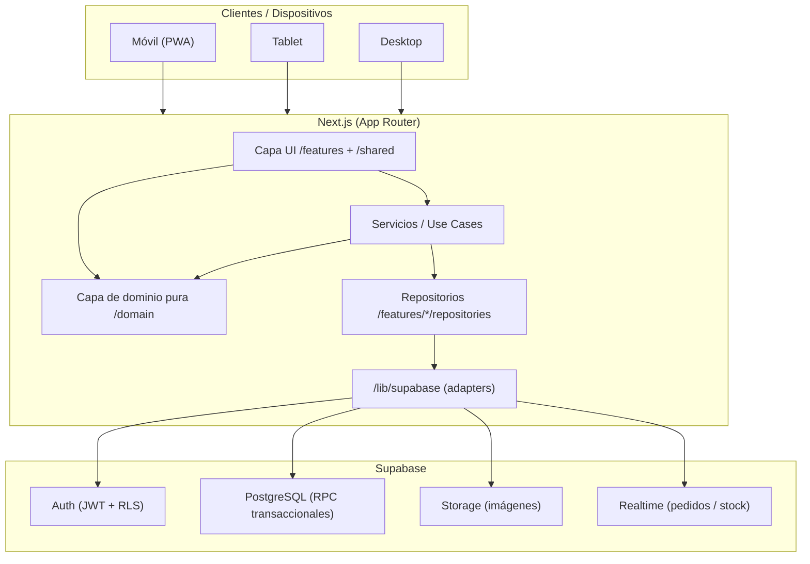
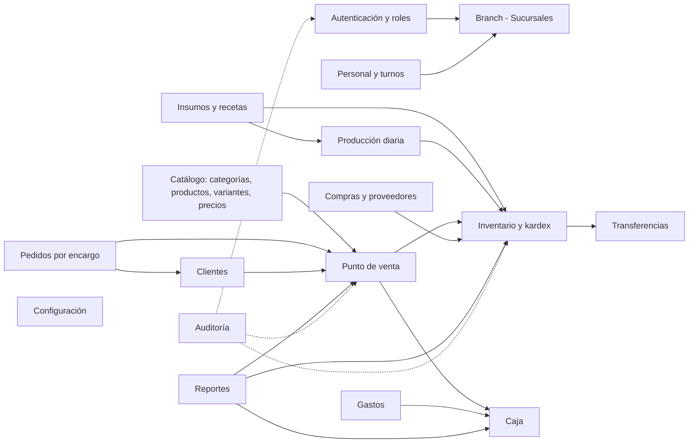
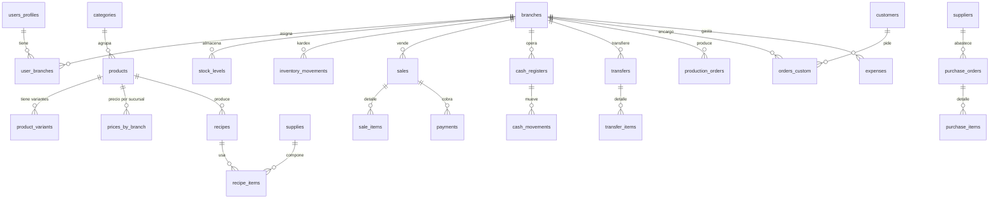
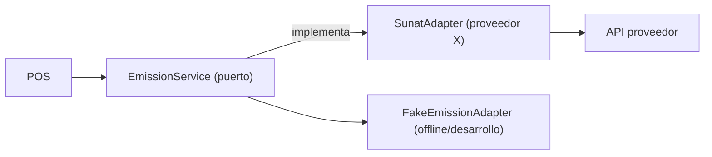
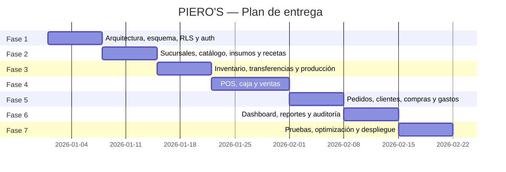

# PIERO'S — Documento de Arquitectura

Sistema de gestión profesional, multisucursal y responsive para la pastelería
**PIERO'S** (Ayacucho, Perú). Este documento describe la arquitectura técnica,
las decisiones adoptadas y la estructura del repositorio. Es la referencia
técnica del proyecto; el contexto de negocio vive en `README.md`.

> Convención de marca: **PIERO'S** se escribe siempre en mayúsculas en títulos
> y encabezados.

---

## 1. Visión general



- **Frontend:** Next.js (App Router) con TypeScript estricto, Tailwind CSS y
  shadcn/ui. Mobile-first, PWA para el POS sin conexión.
- **Backend/BBDD:** Supabase (PostgreSQL). La lógica transaccional crítica vive
  en funciones PostgreSQL (`RPC`) para garantizar consistencia.
- **Dominio puro:** reglas de negocio en funciones puras, testeadas con Vitest,
  sin dependencias de UI ni de Supabase.

---

## 2. Decisiones técnicas (ADR resumido)

| #   | Decisión                                          | Motivo                                                                                                  |
| --- | ------------------------------------------------- | ------------------------------------------------------------------------------------------------------- |
| 1   | **Next.js App Router + RSC**                      | Rutas por archivo, layouts anidados, streaming y SSR. Estándar actual.                                  |
| 2   | **shadcn/ui + Tailwind**                          | Componentes accesibles y copiables al repo (no dependencia cerrada). Fácil de tematizar con tokens CSS. |
| 3   | **Tokens de color CSS (HSL)**                     | La paleta rosa cambia editando un solo lugar (`app/globals.css`).                                       |
| 4   | **Supabase como BaaS**                            | Auth + RLS + Storage + Realtime en un solo servicio.                                                    |
| 5   | **RLS en TODAS las tablas**                       | Seguridad a nivel de fila por rol y por sucursal asignada. No confiar solo en la UI.                    |
| 6   | **RPC transaccionales para operaciones críticas** | Venta, cierre de caja, transferencias y ajustes son atómicos en PostgreSQL.                             |
| 7   | **Patrón Repository + Adapter**                   | Los componentes nunca llaman a Supabase directamente; se puede cambiar de proveedor.                    |
| 8   | **Capa de dominio pura**                          | Cálculos de precios, IGV, costo de recetas y descuento de stock sin dependencias. Testeable.            |
| 9   | **TanStack Query**                                | Caché, revalidación y sincronización del estado del servidor.                                           |
| 10  | **React Hook Form + Zod**                         | Formularios con validación tipada compartida entre cliente y servicios.                                 |
| 11  | **SUNAT desacoplada**                             | Módulo de facturación electrónica como adapter; no se implementa completo (ver §7).                     |
| 12  | **Nunca exponer `service_role`**                  | Solo el servidor (RSC/API routes) usa la clave de servicio.                                             |

---

## 3. Modelo de dominio (módulos)



---

## 4. Modelo de datos (resumen)

Identificadores `UUID`, timestamps `timestamptz`, soft-delete donde aplica y
numeración de comprobantes por sucursal. Diagrama simplificado:



Tablas (29 + enums + funciones):

- **Acceso:** `branches`, `users_profiles`, `user_branches`
- **Catálogo:** `categories`, `products`, `product_variants`, `prices_by_branch`
- **Insumos/recetas:** `supplies`, `recipes`, `recipe_items`
- **Inventario:** `stock_levels`, `inventory_movements`
- **Logística:** `transfers`, `transfer_items`
- **Producción:** `production_orders`
- **Venta/POS:** `sales`, `sale_items`, `payments`
- **Encargos:** `orders_custom`, `order_payments`
- **Caja:** `cash_registers`, `cash_movements`
- **Clientes/proveedores:** `customers`, `suppliers`
- **Compras:** `purchase_orders`, `purchase_items`
- **Gastos:** `expenses`
- **Personal (opcional):** `employees`, `shifts`
- **Transversal:** `audit_logs`, `business_settings`

---

## 5. Roles y matriz de permisos

| Acción                               | SUPER_ADMIN |  ADMIN_SUCURSAL   | CAJERO | PRODUCCION | VENDEDOR_SOLO_LECTURA |
| ------------------------------------ | :---------: | :---------------: | :----: | :--------: | :-------------------: |
| Todas las sucursales / config global |     ✅      | ❌ (solo la suya) |   ❌   |     ❌     |          ❌           |
| Gestionar usuarios y roles           |     ✅      |        ❌         |   ❌   |     ❌     |          ❌           |
| Catálogo y precios                   |     ✅      |        ✅         |   ❌   |     ❌     |          ❌           |
| Insumos y recetas                    |     ✅      |        ✅         |   ❌   |     ✅     |          ❌           |
| Inventario / ajustes / mermas        |     ✅      |        ✅         |   ❌   |     ✅     |          ❌           |
| Transferencias                       |     ✅      |        ✅         |   ❌   |     ✅     |          ❌           |
| Órdenes de producción                |     ✅      |        ✅         |   ❌   |     ✅     |          ❌           |
| Venta (POS)                          |     ✅      |        ✅         |   ✅   |     ❌     |          ❌           |
| Caja (apertura/cierre)               |     ✅      |        ✅         |   ✅   |     ❌     |          ❌           |
| Pedidos por encargo                  |     ✅      |        ✅         |   ✅   |     ❌     |          ❌           |
| Compras / gastos                     |     ✅      |        ✅         |   ❌   |     ❌     |          ❌           |
| Consulta (solo lectura)              |     ✅      |        ✅         |   ✅   |     ✅     |          ✅           |

Cada usuario ve únicamente los datos de las sucursales que tiene asignadas en
`user_branches` (salvo `SUPER_ADMIN`, que ve todas). La RLS se apoya en
`is_super_admin()` y `user_has_branch_access(branch_id)`.

---

## 6. Estructura de carpetas

```
pieros/
├── app/                        # Rutas (App Router)
│   ├── (auth)/                 # login, recuperación, callback
│   ├── (app)/                  # zona autenticada (sidebar + topbar)
│   │   ├── page.tsx            # dashboard
│   │   ├── sucursales/
│   │   ├── catalogo/
│   │   ├── inventario/
│   │   ├── produccion/
│   │   ├── pos/
│   │   ├── pedidos/
│   │   ├── caja/
│   │   ├── clientes/
│   │   ├── compras/
│   │   ├── gastos/
│   │   ├── reportes/
│   │   ├── configuracion/
│   │   └── usuarios/
│   ├── layout.tsx              # proveedores, fuentes, toasts
│   └── globals.css             # tokens de color (paleta rosa)
├── features/                   # arquitectura por dominio
│   └── <modulo>/
│       ├── components/
│       ├── hooks/
│       ├── services/           # casos de uso
│       ├── repositories/       # acceso a datos (adapter)
│       ├── schemas/            # Zod
│       └── types/
├── shared/
│   ├── components/ui/          # shadcn/ui
│   ├── lib/                    # utils, formatters
│   └── types/                  # tipos compartidos (DB)
├── domain/                     # capa de dominio PURA (sin UI/Supabase)
│   ├── pricing.ts
│   ├── inventory.ts
│   ├── recipes.ts
│   └── index.ts
├── lib/
│   ├── supabase/               # client, server, admin, middleware
│   └── audit.ts                # auditoría de acciones sensibles
├── tests/
│   ├── unit/                   # Vitest (dominio + servicios)
│   └── e2e/                    # Playwright (venta, cierre, transferencia)
├── supabase/
│   ├── migrations/             # migraciones versionadas (Supabase CLI)
│   ├── seed.sql                # datos de ejemplo (2 sucursales Ayacucho)
│   ├── tests/                  # tests de RLS (pgTAP)
│   └── config.toml
├── middleware.ts               # protección de rutas + refresh de sesión
├── docs/ARQUITECTURA.md
└── README.md
```

---

## 7. Facturación electrónica SUNAT (módulo desacoplado)

El sistema **no** emite comprobantes electrónicos en esta versión. Se diseña una
interfaz de integración para conectar un proveedor (p. ej. Nubefact, FacturaloPeru,
CONCYSUNAT):



- **Puerto** `EmissionService` (en `features/facturacion/services/`): método
  `emitir(comprobante) => { cdr, numero, enlace_xml_pdf }`.
- **Adapter** `SunatAdapter`: implementa el puerto llamando a la API del
  proveedor; `FakeEmissionAdapter` permite probar el flujo sin proveedor.
- El tipo de comprobante (boleta/factura) y las series se configuran por
  sucursal en `branches.serie_boleta` / `branches.serie_factura`.
- **Cómo conectar un proveedor:** implementar `SunatAdapter` con las credenciales
  (nunca en el frontend), registrar el adapter en el contenedor de DI y añadir la
  configuración en `business_settings`. Ver `README.md §Facturación SUNAT`.

---

## 8. Plan de fases



| Fase  | Alcance                                                | Criterio de salida                                                  |
| ----- | ------------------------------------------------------ | ------------------------------------------------------------------- |
| **1** | Arquitectura, esquema BBDD, RLS, autenticación y roles | Login/roles funcionando, `verificar_schema` en verde, tests de RLS  |
| **2** | Sucursales, catálogo, insumos y recetas                | CRUD completo + costo de recetas calculado                          |
| **3** | Inventario, transferencias y producción                | Kardex, ajustes, mermas, transferencias confirmadas                 |
| **4** | POS, caja y ventas                                     | Venta descuenta stock y actualiza caja (RPC), ticket 80 mm, offline |
| **5** | Pedidos por encargo, clientes, compras y gastos        | Flujos completos con anticipo/saldo                                 |
| **6** | Dashboard, reportes y auditoría                        | KPIs, exportación Excel/PDF, logs de acciones sensibles             |
| **7** | Pruebas, optimización y despliegue                     | Playwright en verde, lighthouse aceptable, deploy Vercel + Supabase |

---

## 9. Seguridad y calidad

- **RLS activada** en las 29 tablas; políticas por rol (lectura con
  `user_has_branch_access`, escritura con `get_user_role_in_branch`).
- **`SUPER_ADMIN` salta la RLS**; protegido por trigger que impide el
  auto-ascenso de rol desde el cliente. El primer superadmin se promueve desde
  el SQL Editor.
- **Toda función `SECURITY DEFINER` lleva `SET search_path`** para evitar
  secuestro del `search_path`.
- **Auditoría** (`audit_logs`) vía función `record_audit()` para acciones
  sensibles (anulaciones, descuentos, ajustes, cambios de precio).
- **Testing:** Vitest para dominio y servicios; Playwright para venta, cierre de
  caja y transferencia; pgTAP para políticas RLS.
- **CI/CD:** ESLint + Prettier + Husky + commitlint (convencionales).
